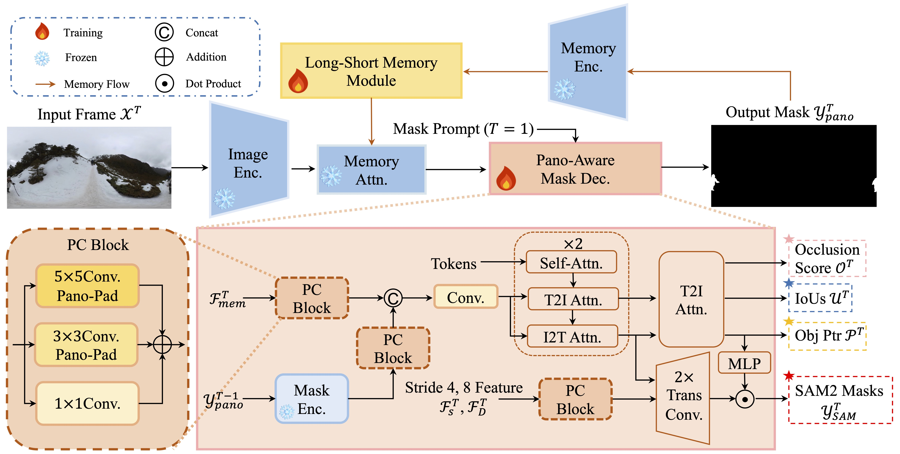
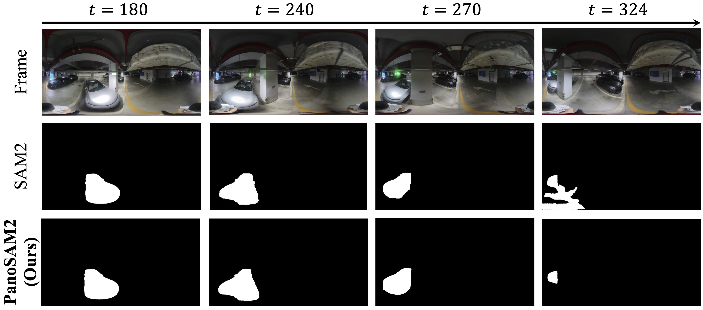

<div align="center">
<h1>PanoSAM2: Lightweight Distortion- and Memory-aware Adaptions of SAM2 for 360 Video Object Segmentation</h1>

[**Dingwen Xiao**](https://scholar.google.com/citations?hl=zh-CN&user=Zd-5kV4AAAAJ)<sup>*1</sup> · [**Weiming Zhang**](https://scholar.google.com/citations?hl=zh-CN&user=cdtgqkgAAAAJ)<sup>*1</sup> · [**Shiqi Wen**](https://scholar.google.com/citations?user=Rr1qsVgAAAAJ&hl=zh-CN&authuser=1)<sup>1</sup> · [**Lin WANG**](https://scholar.google.com/citations?user=SReb2csAAAAJ&hl=zh-CN)<sup>2&dagger;</sup> 

<sup>1</sup>AI Thrust, HKUST (GZ)&emsp;<sup>2</sup>NTU
<br>

<a href="https://arxiv.org/abs/2604.07901"></a>
</div>

---

## Overview



PanoSAM2 is a lightweight adaptation of SAM2 for 360° video object segmentation. It introduces three novel modules to address the unique challenges of panoramic (equirectangular projection, ERP) videos.

## Environment

The project is mainly based on [SAM2](https://github.com/facebookresearch/sam2). Tested with Python 3.10.18 on CUDA 12.8. Key dependencies:

```
torch==2.7.1
torchvision==0.22.1
torchaudio==2.7.1
triton==3.3.1
xformers==0.0.31
numpy==2.2.6
pandas==2.3.1
scipy==1.15.3
opencv-python-headless==4.12.0.88
pillow==11.3.0
tqdm==4.67.1
hydra-core==1.3.2
omegaconf==2.3.0
shapely==2.1.1
matplotlib==3.10.5
seaborn==0.13.2
scikit-image==0.25.2
imageio==2.37.0
CRF==0.0.1
cc-torch==0.1.0
py360convert==1.0.4
gdown==5.2.0
```


## Data Preparation

The pretrained SAM2 checkpoints should be placed under a directory (default relative path `../../../Pretrained-Models/SAM2/`). Available backbones: `t` (tiny), `s` (small), `b+` (base_plus), `l` (large). The backbone is configured in `config.py` via the `backbone` field.

Expected datasets layout:

```
../Dataset/
├── 360VOTS/
│   ├── train/
│   │   ├── 000/
│   │   │   ├── image/000000.jpg ...
│   │   │   └── mask/000000.png ...
│   │   └── train_mask_weight/000/<obj_id>/000000.npy
│   ├── test/
│   └── train.csv, test.csv
└── PanoVOS/
    ├── train/
    │   ├── JPEGImages/<video>/
    │   ├── Annotations/<video>/
    │   └── train_mask_weight/<video>/<obj_id>/*.npy
    └── train.csv
```

## Usage

### Training

Training uses distributed data parallel (DDP). Configure the dataset, backbone, and hyperparameters in `config.py` (`Config` class).

```bash
# 2 GPUs for example
CUDA_VISIBLE_DEVICES=0,1 python3 -m torch.distributed.launch --nproc_per_node=2 train.py
```

### Inference on a Custom Video

Provide a frame directory and an initial mask.

```bash
python open_video_input.py \
    --video_frame_dir <your input frames dir> \
    --mask_path <your initial mask path> \
    --ckpt_path <your weight path> \
    --device cuda
```

## Open-World Visualizations



## Citation

If you find this work useful, please cite:

```bibtex
@article{xiao2026panosam2,
  title={PanoSAM2: Lightweight Distortion-and Memory-aware Adaptions of SAM2 for 360 Video Object Segmentation},
  author={Xiao, Dingwen and Zhang, Weiming and Wen, Shiqi and Wang, Lin},
  journal={arXiv preprint arXiv:2604.07901},
  year={2026}
}
```
